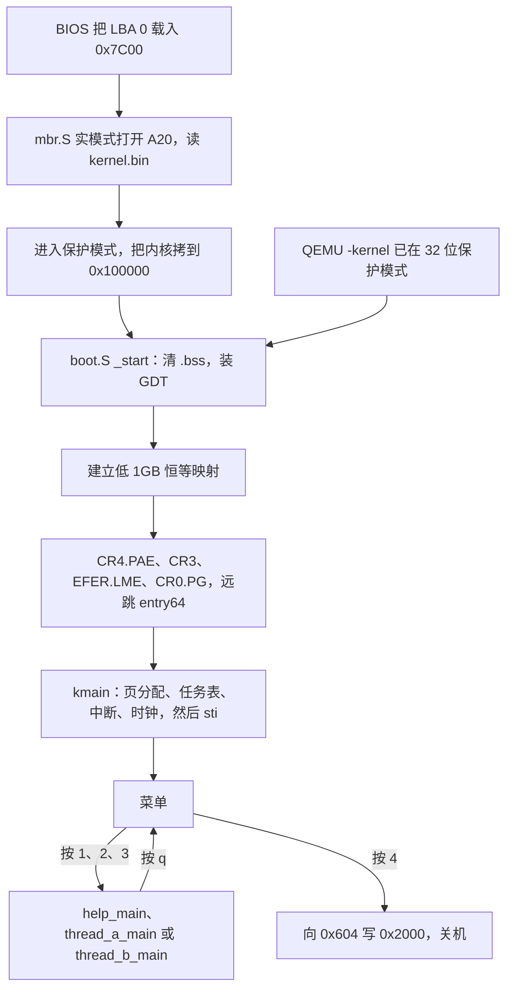

# myos

一个可以在 QEMU 里启动的 x86_64 小内核。它从 32 位保护模式进入 64 位，清掉未初始化数据，然后在屏幕上画出菜单。

菜单四项：

```text
menu
1  help
2  run thread_a
3  run thread_b
4  power off
```

前三项的代码在 `user/` 里，和内核链进同一个 `boot.elf`。按下对应键就直接调用那个函数。函数和菜单共用启动栈，调用 `vga_putc`、`serial_putc`、`kbd_poll`。按 `q` 返回后，菜单再画一次。按 `4` 向端口 `0x604` 写 `0x2000`，QEMU 退出。

屏幕是 `0xB8000` 上的 80×25 文字，只用 ASCII。同一份输出也写到 COM1。这台机器没有图形界面，`make run` 和 `make boot` 用 `-display curses` 把文字画在终端里，串口记到 `serial.log`。

```bash
make
make check
make run
make boot
```

`make` 生成 `boot.elf`。`make check` 确认里面还有 Multiboot 头。`make run` 把它转成 `boot32.elf`，用 QEMU 的 `-kernel` 启动。`make boot` 做成 `myos.img`，从硬盘的第一个扇区启动，不使用 `-kernel`。curses 占着当前终端，Ctrl-C 停不掉 QEMU。按 `4` 关机，或按 Esc 再按 2，在监视器里输入 `quit`。

更长的设计笔记在 `md/DESIGN.md`，写入 U 盘的步骤在 `md/INSTALL.md`。

## 源码结构

| 文件 | 作用 |
| --- | --- |
| `mbr.S`、`mbr.ld` | 磁盘第一个扇区。实模式读内核，打开 A20，进入保护模式 |
| `boot.S` | 清 `.bss`，装 GDT 和低 1GB 页表，进入长模式，调用 `kmain` |
| `linker.ld` | 内核放在物理地址 `0x100000`，末尾是三页页表和 4KB 启动栈 |
| `kernel.h` | 各文件之间的函数声明 |
| `kmain.c` | 初始化，然后按 `items` 表显示菜单并调用函数 |
| `user/help.c` | 按键 `1`，打印帮助 |
| `user/thread_a.c` | 按键 `2`，连续输出 `A` |
| `user/thread_b.c` | 按键 `3`，连续输出 `B` |
| `vga.c` | 写 `0xB8000` |
| `kbd.c` | 查询 PS/2 端口 `0x60`，认识 `1` 到 `4` 和 `q` |
| `serial.c` | COM1 `0x3f8`，以及 `panic` |
| `pmm.c` | 物理页位图，一页 4KB |
| `task.c`、`swtch.S` | 最多 8 个任务和换栈。菜单这条路径不调用它们 |
| `idt.c`、`trap.S` | 异常门和时钟中断 |
| `pic.c` | 8259 只放行 IRQ0，PIT 约 100Hz |
| `Makefile` | 编译、检查、做磁盘镜像、启动 |

`kmain.c` 里的表把按键、标题和函数写在一起：

```c
static const struct item items[] = {
	{ '1', "help", help_main },
	{ '2', "run thread_a", thread_a_main },
	{ '3', "run thread_b", thread_b_main },
};
```

`4  power off` 写在 `show_menu` 里。关机要写硬件端口，留在 `kmain.c`。再加一个程序时，新建 `user/` 下的 C 文件，在 `kernel.h` 声明，往这张表加一行，并把文件放进 `Makefile` 的 `SRCS`。

## 功能

启动之后 CPU 已经在长模式。低 1GB 做了恒等映射，虚拟地址等于物理地址。内核链在 `0x100000`，启动栈是映像末尾的 4KB，栈顶是 `stack_top`。

`kmain` 的顺序是 `pmm_init`、`task_init`、`idt_init`、`pic_init`、`pit_init`，然后 `sti` 打开中断，进入菜单。`sti` 之前 `boot.S` 里的 `cli` 一直有效。时钟大约 100Hz。菜单用 `hlt` 等键，时钟中断把它唤醒后再查键盘。

`pmm.c` 用位图记录空闲物理页，默认按 128MB 计算；`-kernel` 启动并且 Multiboot 信息有效时，改用引导程序给出的内存大小，上限是已经映射的 1GB。位图只覆盖 256MB。菜单本身不分配页。`task_create` 才会取一页当任务栈。

`task.c` 里有轮转调度。时钟中断会调用 `yield_if_task`。菜单运行时没有当前任务，这个函数直接返回，所以菜单和 `user/` 里的函数不会被换走。

异常进入 `trap_handler`，从串口打印向量后停机。这一版不做缺页换入，也没有用户态、系统调用和多核。

## 启动过程

从磁盘启动和 `make run` 在 `boot.S` 的 `_start` 会合。



磁盘路径里，CPU 的第一条指令在 `mbr.S`，地址 `0x7C00`，还是 16 位实模式。它用 BIOS 中断把 `kernel.bin` 从 LBA 1 读进来，打开 A20，置 `CR0.PE`，再跳到内核入口。`myos.img` 的 LBA 0 是这 512 字节，后面紧接着 `kernel.bin`。

`make run` 没有引导扇区。QEMU 认出 `boot32.elf` 里的 Multiboot 头，自己把映像放到 1MB，带着魔数 `0x2BADB002` 进入 `_start`。磁盘启动时没有这个魔数，`pmm_init` 就按 128MB 计算。

`_start` 清 `.bss`，保存 EAX 和 EBX，装上 GDT，确认 CPU 支持长模式。不支持时长模式检查停在屏幕左上角的红底白字 `NO`。支持时，三页页表把低 1GB 映成 512 个 2MB 页，然后按 PAE、页表基址、`EFER.LME`、打开分页的顺序写控制寄存器。远跳到 `entry64` 之后才按 64 位指令执行。`entry64` 把栈设到 `stack_top`，调用 `kmain`。`menu` 不返回。
